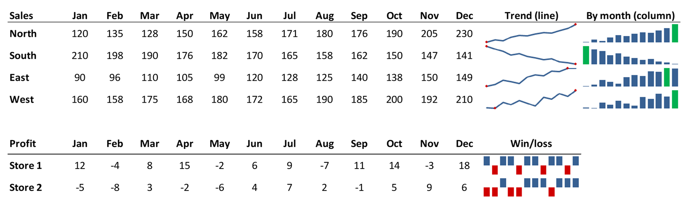

# Sparklines

Sparklines are small charts drawn inside single cells, beside the data they chart, as
Excel's *Insert → Sparklines* makes them. [`XLSX.addSparklines`](@ref) adds a group of
them, as lines, columns or win/loss bars. The file must be open for writing
(`mode="rw"`, or a new workbook from [`XLSX.newxlsx`](@ref)).

Each sparkline shows the shape of one row (or column) of figures at a glance:

- **Line:** shows the trend. The example below marks each region's highest and lowest month in red.
- **Column:** compares the months' sizes. The example below shows the highest in green.
- **Win/loss:** shows only whether each value is positive or negative. Here, a profit is a blue bar above the line and a loss a red bar below it.



The sheet in the picture was made with:

```julia
XLSX.addSparklines(s, "N2:N5", "B2:M5"; high=true, low=true, lineWeight=1.25)
XLSX.addSparklines(s, "O2:O5", "B2:M5"; type=:column, high=true, highColor="00B050")
XLSX.addSparklines(s, "N8:N9", "B8:M9"; type=:winloss)
```

```jldoctest sparklines; setup = :(import XLSX)
julia> xf = XLSX.newxlsx("Sales");

julia> s = xf["Sales"];

julia> s["A1:D3"] = [3 5 4 7; 6 2 8 1; -1 2 -3 4];

julia> XLSX.addSparklines(s, "E1:E2", "A1:D2"; markers=true)   # one per row

julia> XLSX.addSparklines(s, "E3", "A3:D3"; type=:winloss)

julia> [(g.type, g.sparklines) for g in XLSX.getSparklines(s)]
2-element Vector{Tuple{Symbol, Vector{Pair{String, String}}}}:
 (:winloss, ["E3" => "Sales!A3:D3"])
 (:line, ["E1" => "Sales!A1:D1", "E2" => "Sales!A2:D2"])
```

The cells for the sparklines are one cell, or a row or column of them:

- a column of cells takes one sparkline for each row of the data;
- a row of cells takes one sparkline for each column of the data;
- one cell takes a row or column of data.

The data can be on another sheet: `"Data!B2:M13"`. Each call makes one group, whose
sparklines share their options, as in Excel: a type (`:line`, `:column` or `:winloss`),
markers for every point or for the high, low, first, last and negative points, colours
for each, the horizontal axis, how empty cells are shown (`emptyCells=:gap`, `:zero` or
`:span`), the line's weight, the vertical axis's limits (`min` and `max`: each sparkline
`:individual`, the group alike, or a number), and a range of dates to space the points
by. See [`XLSX.addSparklines`](@ref) for them all.

```julia
XLSX.addSparklines(sheet, "N2:N13", "B2:M13"; high=true, low=true, highColor="green", lowColor="red")
XLSX.addSparklines(sheet, "B14:M14", "B2:M13"; type=:column, min=0, max=:group)
```

A sparkline added in a cell that has one replaces it. [`XLSX.getSparklines`](@ref) reads
the groups and their options, from any file, and [`XLSX.deleteSparklines`](@ref) deletes
the sparklines in some cells, or with `group=true` their whole groups.

## Editing the sheet

Sparklines follow their cells and data as Excel's do:

- **Inserting and deleting rows and columns:** sparklines and their data move.
  - Rows inserted below a sparkline get one of their own, in its group and charting their own cells, as Excel's "Format Same As Above" gives them. Columns inserted to the right of one get one in the same way.
  - A sparkline whose cell is deleted is deleted.
  - A sparkline whose data is deleted stays, without data.
- **Renaming a sheet:** the sparklines' data follows it.
- **Copying a sheet:** the copy's sparklines chart the copy.
- **Deleting a sheet:** sparklines elsewhere that charted it are left without data.

## See also

- API: [Sparklines](../api/charts.md#Sparklines) on the Charts page
- Related guides: [Conditional formats](../formatting/conditionalFormatting.md), whose data bars and colour scales also show values in their cells
