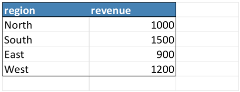
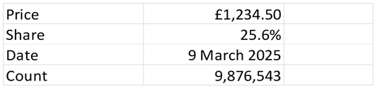
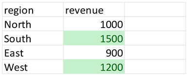
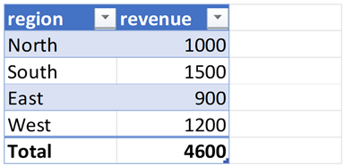
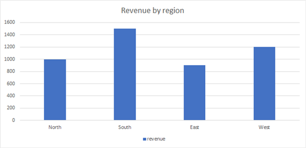
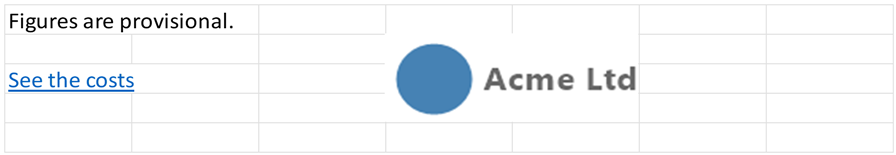

# Cookbook

Short answers to common questions, each with the code to do it. Every recipe links to
the guide that covers the topic in full.

The recipes run in order: most use the `sales` DataFrame from the first recipe, and the
`sales.xlsx` and `report.xlsx` files written by the first two. They need these packages:

```julia
using XLSX, DataFrames, Dates
```

## Reading and writing data

### How do I write a DataFrame to a new file?

```julia
sales = DataFrame(region=["North", "South", "East", "West"], revenue=[1000, 1500, 900, 1200])
XLSX.writetable("sales.xlsx", sales; sheetname="Sales", overwrite=true)
```

`overwrite=true` replaces the file if it exists. See
[Export Tabular Data from any `Tables.jl` compatible source](@ref).

### How do I write several DataFrames to separate sheets?

Give each sheet's name and its table as a pair:

```julia
costs = DataFrame(item=["Rent", "Staff", "Travel"], amount=[400, 2500, 320])
XLSX.writetable("report.xlsx", "Sales" => sales, "Costs" => costs; overwrite=true)
```

### How do I read a sheet into a DataFrame?

```julia
df = DataFrame(XLSX.readtable("report.xlsx", "Costs"))
```

See [Read Tabular Data](@ref) for choosing the columns and the first row, and
[Reading Large Excel Files and Caching](@ref) for files too big for memory.

### How do I add a sheet to an existing file?

```julia
XLSX.openxlsx("report.xlsx", mode="rw") do xf
    notes = XLSX.addsheet!(xf, "Notes")
    notes["A1"] = "Figures are provisional."
end
```

The file is saved when the block ends. See
[Creating and editing workbooks](tutorial/creatingWorkbooks.md) and
[Managing worksheets](sheets/worksheets.md).

### How do I read a named range into Julia?

```julia
XLSX.openxlsx("report.xlsx", mode="rw") do xf
    XLSX.addDefinedName(xf, "Revenue", "Sales!B2:B5")
end

revenue = vec(XLSX.readxlsx("report.xlsx")["Revenue"])
```

Indexing a file with a name gives the cells it refers to as a matrix; `vec` makes it a
vector. See [Named ranges](formulae/namedRanges.md).

## Formatting

### How do I format a header row?

```julia
xf = XLSX.opentemplate("sales.xlsx")
s = xf["Sales"]
XLSX.setFont(s, "A1:B1"; bold=true, color="white")
XLSX.setFill(s, "A1:B1"; pattern="solid", fgColor="steelblue")
XLSX.setBorder(s, "A2:B2"; top=["style" => "medium", "color" => "black"])        # a line under the header
XLSX.setBorder(s, "A1:B5"; outside=["style" => "thin", "color" => "black"])       # a box round the table
XLSX.setColumnWidth(s, "A:B"; width=14)
XLSX.writexlsx("sales_formatted.xlsx", xf; overwrite=true)
```



See [Cell formats](formatting/cellFormatting.md).

### How do I show numbers as currency, percentages or dates?

```julia
xf = XLSX.newxlsx("Formats")
s = xf["Formats"]
s["A1:A4"] = ["Price", "Share", "Date", "Count"]
s["B1:B4"] = [1234.5, 0.256, Date(2025, 3, 9), 9876543]
XLSX.setFormat(s, "B1"; format="Currency")
XLSX.setFormat(s, "B2"; format="0.0%")
XLSX.setFormat(s, "B3"; format="d mmmm yyyy")
XLSX.setFormat(s, "B4"; format="#,##0")
XLSX.setColumnWidth(s, "A:B"; width=16)
XLSX.writexlsx("formats.xlsx", xf; overwrite=true)
```



The value in each cell is unchanged; only how it is shown. `"Currency"` uses the currency
of whoever opens the file. See [Number formats](@ref).

### How do I highlight values above a threshold?

A conditional format re-applies itself in Excel whenever the values change:

```julia
xf = XLSX.opentemplate("sales.xlsx")
s = xf["Sales"]
XLSX.setConditionalFormat(s, "B2:B5", :cellIs;
                          operator="greaterThan", value="1100", dxStyle="greenfilltext")
XLSX.writexlsx("sales_highlight.xlsx", xf; overwrite=true)
```



See [Conditional formats](formatting/conditionalFormatting.md) for data bars, color
scales, icon sets and other rules.

## Excel features

### How do I make an Excel Table with a totals row?

```julia
XLSX.writetable("sales_table.xlsx", sales; overwrite=true,
                as_table=true, table_name="Sales", table_style="TableStyleMedium2",
                totals=["region" => "Total", "revenue" => :sum])
```



See [Excel Tables](tables/excelTables.md).

### How do I create a chart from a DataFrame?

Write the data, then add a chart that plots it:

```julia
using XLSX.Charts

xf = XLSX.newxlsx("Sales")
s = xf["Sales"]
XLSX.writetable!(s, sales)
c = addChart(s, :column; anchor="D2:K17", title="Revenue by region")
addSeries(c, "B2:B5"; categories="A2:A5", name_ref="B1")
XLSX.writexlsx("sales_chart.xlsx", xf; overwrite=true)
```



The chart is a native Excel chart, drawn from the cells. See
[Creating charts](charts/creatingCharts.md).

### How do I make a drop-down list?

```julia
XLSX.openxlsx("sales.xlsx", mode="rw") do xf
    s = xf["Sales"]
    s["C1"] = "Status"
    XLSX.addDataValidation(s, "C2:C5"; values=["Open", "Closed", "On hold"])
end
```

For a longer list, put the items in cells and refer to them. See
[Drop-down lists](@ref).

### How do I freeze the header row?

```julia
XLSX.openxlsx("sales.xlsx", mode="rw") do xf
    XLSX.freezePanes(xf["Sales"])        # row 1 stays in view as the sheet scrolls
end
```

See [Freeze and split panes](formatting/freezeAndSplitPanes.md).

### How do I group detail rows so they can be collapsed?

```julia
xf = XLSX.newxlsx("Budget")
s = xf["Budget"]
s["A1:A7"] = ["Item", "Rent", "Rates", "Premises total", "Salaries", "Pensions", "Staff total"]
s["B1:B7"] = ["Cost", 400, 120, 520, 2500, 300, 2800]
XLSX.groupRows(s, 2:3)                   # shown, with a button on row 4
XLSX.groupRows(s, 5:6; collapsed=true)   # hidden, with a button on row 7
XLSX.writexlsx("budget.xlsx", xf; overwrite=true)
```

See [Hiding and grouping rows and columns](formatting/hideAndGroup.md).

### How do I insert an image or logo?

```julia
XLSX.openxlsx("report.xlsx", mode="rw") do xf
    XLSX.addImage(xf["Notes"], "D2", "logo.png")   # PNG, JPEG or GIF, at its own size
end
```

See [Images](sheets/images.md), including how to insert a plot made in Julia.

### How do I link to another sheet?

```julia
XLSX.openxlsx("report.xlsx", mode="rw") do xf
    XLSX.addHyperlink(xf["Notes"], "A3"; location="Costs!A1", display="See the costs")
end
```



See [Hyperlinks](sheets/hyperlinks.md).

### How do I add a comment to a cell?

```julia
XLSX.openxlsx("report.xlsx", mode="rw") do xf
    XLSX.addComment(xf["Costs"], "B3", "Includes overtime"; author="Finance")
end
```

See [Comments](sheets/comments.md).

## Sheets, protection and printing

### How do I make a copy of a sheet for each region?

```julia
xf = XLSX.newxlsx("Template")
template = xf["Template"]
template["A1"] = "Region:"
for region in ["North", "South", "East"]
    copy = XLSX.copysheet!(template, region)
    copy["B1"] = region
end
XLSX.setSheetVisibility(template, :hidden)
XLSX.writexlsx("regions.xlsx", xf; overwrite=true)
```

See [Managing worksheets](sheets/worksheets.md).

### How do I protect a sheet but leave some cells editable?

```julia
xf = XLSX.newxlsx("Form")
s = xf["Form"]
s["A1:A3"] = ["Name", "Email", "Phone"]
XLSX.setCellProtection(s, "B1:B3"; locked=false)   # the cells to fill in
XLSX.protectSheet(s; password="secret")
XLSX.writexlsx("form.xlsx", xf; overwrite=true)
```

Sheet protection prevents mistakes; it is not security. See
[Protecting a sheet](sheets/protection.md).

### How do I set a sheet up for printing?

```julia
XLSX.openxlsx("report.xlsx", mode="rw") do xf
    s = xf["Sales"]
    XLSX.setPageSetup(s; orientation=:landscape, paperSize=:A4, fitToWidth=1)
    XLSX.setPrintTitles(s; rows=1)                 # repeat the header row on every page
end
```

See [Printing](@ref).
