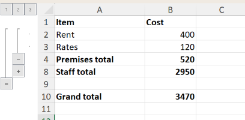

# Hiding and grouping rows and columns

Rows and columns can be hidden, and grouped so that Excel shows an outline
control (the `+` and `-` buttons beside the headings) that hides and shows them.
These change the workbook, so open the file with `mode="rw"` (or start from
[`XLSX.newxlsx`](@ref)). They can be read from any file.

## Which rows and columns

Each function takes the rows or columns in any of these forms (see also
[Addressing cells and ranges](../concepts/addressing.md)):

```julia
XLSX.setColumnHidden(sheet, 3)            # a column number
XLSX.setColumnHidden(sheet, 3:5)          # a range of numbers
XLSX.setColumnHidden(sheet, [2, 6, 7])    # a vector of numbers
XLSX.setColumnHidden(sheet, "C:E")        # column letters, or "C"
XLSX.setColumnHidden(sheet, "C1:E10")     # cells: their columns are used
XLSX.setColumnHidden(sheet, "B:C,F")      # several of these
XLSX.setColumnHidden(sheet, "Totals")     # a defined name

XLSX.setRowHidden(sheet, "3:5")           # rows: "3", "3:5", "A3:E5", ...
XLSX.setRowHidden(xf, "Sheet1!3:5")       # with an XLSXFile, give the sheet
```

Rows and columns needn't hold any data.

## Hiding

```julia
XLSX.setColumnHidden(sheet, "C:D")
XLSX.setRowHidden(sheet, 2:4)

XLSX.isColumnHidden(sheet, "C")   # true
XLSX.isRowHidden(sheet, 5)        # false

XLSX.setRowHidden(sheet, 2:4; hidden=false)   # show them again
```

A hidden column keeps its width, and a hidden row its height, for when they are
shown again.

## Grouping

```julia
XLSX.groupRows(sheet, 2:10)
XLSX.groupColumns(sheet, "B:D")
```

Grouping rows that are already grouped makes a group within a group, one outline
level deeper. Excel allows seven levels.

```julia
XLSX.groupRows(sheet, 2:10)
XLSX.groupRows(sheet, 4:6)

XLSX.getRowOutlineLevel(sheet, 3)   # 1
XLSX.getRowOutlineLevel(sheet, 5)   # 2
```

Each group has a summary row, holding the button that hides and shows it.
That is the row just below the group (the column just to its right), as in
Excel, or above (to the left) if the sheet's outline settings say so.

Pass `collapsed=true` to show a group collapsed, with its rows hidden:

```julia
XLSX.groupRows(sheet, 12:20; collapsed=true)
```

For example, a budget with its detail rows grouped under their totals, and both groups
inside one that covers everything above the grand total:

```julia
XLSX.groupRows(sheet, 2:8)                    # level 1
XLSX.groupRows(sheet, 2:3)                    # level 2, shown
XLSX.groupRows(sheet, 5:7; collapsed=true)    # level 2, collapsed
```



Each group's button is on its summary row: row 4 for rows 2–3, row 8 for rows 5–7, and
row 10 for the outer group. The numbered buttons show every group down to that level.

[`XLSX.ungroupRows`](@ref) and [`XLSX.ungroupColumns`](@ref) move rows and
columns out one level. Rows hidden by a collapsed group stay hidden, as in
Excel: show them with `setRowHidden(sheet, rows; hidden=false)`.

## See also

- API: [Sheet layout](../api/sheetLayout.md)
- Related guides: [Filtering](../sheets/autoFilter.md), [Inserting and deleting rows and columns](../sheets/insertDelete.md)
