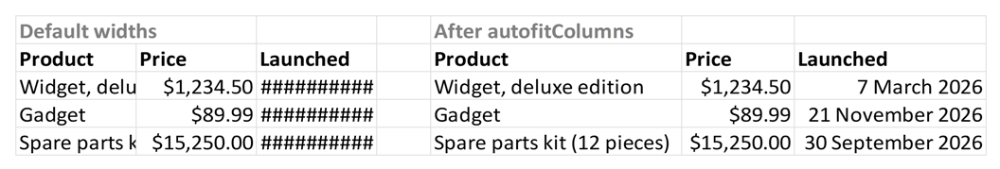

# Column width and row height

Two functions offer the ability to set the column width and row height within a worksheet. These can use 
all of the ways of naming rows and columns described in [Addressing cells and ranges](../concepts/addressing.md). For example:

```julia
julia> XLSX.setRowHeight(s, "A2:A5"; height=25)  # Rows 2 to 5 (columns ignored)

julia> XLSX.setColumnWidth(s, 5:5:100; width=50) # Every 5th column up to column 100.
```

Excel applies some padding to user specified widths and heights. The two functions described here attempt 
to do something similar but it is not an exact match to what Excel does. User specified row heights and 
column widths will therefore differ by a small amount from the values you would see setting the same 
widths in Excel itself.

## Fitting columns to their contents

[`XLSX.autofitColumns`](@ref) sets columns to the width of the widest text in them, as
Excel's *Format → AutoFit Column Width* does. Text is measured as it is shown, in its
number format, font and size, so a formatted price or a long date gets the room it
needs:



```jldoctest autofit; setup = :(import XLSX; using Dates)
julia> s = XLSX.newxlsx()[1];

julia> s["A1"] = ["Product", "Price", "Launched"];

julia> s["A2"] = ["Widget, deluxe edition", 1234.5, Date(2026, 3, 7)];

julia> XLSX.setFormat(s, "B2"; format="\$#,##0.00"); XLSX.setFormat(s, "C2"; format="d mmmm yyyy");

julia> sort(collect(XLSX.autofitColumns(s)))      # column => width
3-element Vector{Pair{Int64, Float64}}:
 1 => 18.93
 2 => 8.28
 3 => 11.57
```

Give columns by letter (`"B:D"`), number or range, and limit the widths with
`min_width` and `max_width`:

```jldoctest autofit
julia> XLSX.autofitColumns(s, "A"; max_width=15)
Dict{Int64, Float64} with 1 entry:
  1 => 15.0
```

The widths are approximate. Characters are measured with the widths Excel 365 uses,
for Calibri, Aptos, Aptos Narrow, Arial, Times New Roman and Courier New; Excel's own
AutoFit gives widths within about 0.2 characters of these for most text, and varies a
little with the screen. Merged cells are left out, as Excel leaves them out.

## See also

- API: [Sheet layout](../api/sheetLayout.md)
- Related guides: [Hiding and grouping rows and columns](hideAndGroup.md), [Cell formats](cellFormatting.md), [Merged cells](mergedCells.md)
- Examples: [Creating a formatted form](@ref)
