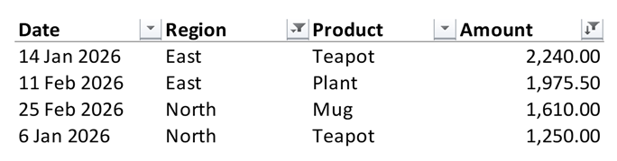

```@meta
DocTestSetup = :(import XLSX)
```

# Filtering

An AutoFilter puts drop-down buttons on the header row of a range, as Excel's
*Data → Filter* does, so that its rows can be filtered and sorted in Excel.
Adding and removing a filter changes the workbook, so open the file with
`mode="rw"` (or start from [`XLSX.newxlsx`](@ref)). Filters can be read from any
file.

```julia
XLSX.openxlsx("sales.xlsx", mode="rw") do xf
    sheet = xf["Sales"]
    XLSX.setAutoFilter(sheet, "A1:F200")   # row 1 holds the headers
end
```

`XLSX.setAutoFilter(sheet, :)` filters the sheet's whole used range. The range
may also be given as a defined name, or with an `XLSXFile` as
`"Sales!A1:F200"`.

A sheet has a single filter, so setting one on a different range replaces any
filter the sheet already has, together with its criteria and sort. Setting the
same range again keeps them, unless new ones are given.

```jldoctest filter; setup = :(import XLSX; sheet = XLSX.newxlsx("Sales")[1]; sheet["A1"] = ["a", "b", "c", "d", "e", "f"]; XLSX.setAutoFilter(sheet, "A1:F200"))
julia> XLSX.getAutoFilter(sheet)
A1:F200

julia> XLSX.removeAutoFilter(sheet)
true
```

Rows that a filter hid stay hidden when the filter is removed. Show them with
[`XLSX.setRowHidden`](@ref)`(sheet, rows; hidden=false)`.

## Filter criteria and sorting

`setAutoFilter` can also filter and sort the range, as choosing from the
buttons in Excel does. Excel doesn't reapply a filter or a sort when it opens a
file, so XLSX.jl does it as it sets them: it hides the rows the criteria don't
show and puts the rows in order. The file then opens just as Excel would have
saved it.

```julia
XLSX.setAutoFilter(sheet, "A1:D9";
    filters = ["Region" => ["North", "East"], "Amount" => (">" => 1000)],
    sort = "Amount" => :descending)
```



`filters` pairs a column with a criterion. The column is given by its header
text, as here, by its letter (`"D"`) or by its position in the range (`4`). A row
is shown if it meets every column's criterion. A criterion is:

| Criterion | Shows |
|:----------|:------|
| `"Red"`, or `["Red", "Blue", missing]` | the cells showing one of the values, in any case; `missing` for empty cells. Numbers, dates (by the day) and `true`/`false` can be listed too. |
| `">" => 1000` | the cells meeting the condition. The operators are `"=="`, `"!="`, `">"`, `">="`, `"<"` and `"<="`. |
| `"==" => "A*"` | text matching a pattern: `*` stands for any characters and `?` for any one character. `~*` is a `*` itself. |
| `(">=" => 10, :and, "<" => 20)` | cells meeting both conditions; `:or` for either. |
| `(:top, 10)`, `(:bottom, 5)`, `(:top, 10, :percent)` | the largest or smallest numbers. |
| `:aboveAverage`, `:belowAverage` | numbers above or below the column's average. |
| `:today`, `:thisWeek`, `:lastMonth`, `:nextQuarter`, `:yearToDate`, ... | dates in a period relative to today, as Excel's *Date Filters* menu offers. A week starts on Sunday. |
| `:Q1` to `:Q4`, `:M1` to `:M12` | dates in a quarter or a month of any year. |

`sort` gives a column, `column => :descending`, or a vector of them to sort by
several. Excel's order is followed: numbers and dates first, then text (in any
case), `TRUE` and `FALSE`, errors, and empty cells last in either direction. Each
row's cells move with their formats, notes and hyperlinks. A formula moves as
Excel moves it, as if copied: `=B5*2` in row 5 becomes `=B2*2` in row 2. Cells
outside the range's columns stay where they are.

```jldoctest sort; setup = :(import XLSX; sheet = XLSX.newxlsx("Scores")[1])
julia> sheet["A1"] = ["Name" "Score"; "Ann" 7; "Bob" 9; "Cy" 4];

julia> XLSX.setAutoFilter(sheet, "A1:B4"; filters = ["Score" => (">" => 5)], sort = "Score" => :descending)

julia> [sheet[r, 1] for r in 2:4]
3-element Vector{String}:
 "Bob"
 "Ann"
 "Cy"

julia> XLSX.isRowHidden(sheet, 4)
true
```

`filters=[]` removes a filter's criteria and shows all its rows. A range with
merged cells, with an array formula, or with a formula shared with cells outside
it can't be sorted. Filtering by colour or by icon isn't supported.

## Filters in Excel Tables

An [Excel Table](../tables/excelTables.md) has filter buttons of its own, so a
sheet's filter and a table may not overlap: `setAutoFilter` refuses a range on
a table, and `addtable!`, `writetable!` with `as_table=true`, `appendtable!` and
`settotals!` refuse to place or grow a table onto the filter. [`XLSX.getAutoFilter`](@ref) returns
only the sheet's filter, not those of its tables.

## Sheet operations

The filter goes with its sheet: [`XLSX.copysheet!`](@ref) gives the copy the same
filter, and [`XLSX.renamesheet!`](@ref) and [`XLSX.deletesheet!`](@ref) keep the
hidden name Excel uses to record the filter's range in step.

## See also

- API: [Sheet layout](../api/sheetLayout.md)
- Related guides: [Excel Tables](../tables/excelTables.md), [Hiding and grouping rows and columns](../formatting/hideAndGroup.md)
