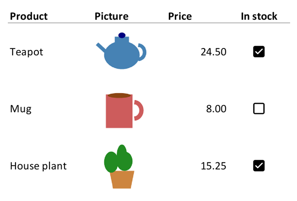

# Images

Adding or deleting images changes the workbook, so open the file with `mode="rw"` (or start
from [`XLSX.newxlsx`](@ref)) and save it afterwards. The functions that only read work on
any file.

[`XLSX.addImage`](@ref) places a PNG, JPEG or GIF image on a worksheet. The image
floats above the grid, as a picture inserted in Excel does. It does not change
any cell, and it can be moved and resized in Excel as usual.

The image's top-left corner is anchored to a cell. With a single cell, the image
keeps its own pixel size, or the size you give:

```julia
XLSX.openxlsx("report.xlsx", mode="rw") do xf
    sheet = xf["Summary"]
    XLSX.addImage(sheet, "B2", "logo.png")                     # native size
    XLSX.addImage(sheet, "H2", "photo.jpg"; size=(200, 150))   # width, height in pixels
end
```

With a cell range, the image is stretched to fill it and `size` is ignored:

```julia
XLSX.addImage(sheet, "B10:F20", "chart.png")
```

The image can also come from an `IOBuffer`, for example a plot rendered in
memory. The buffer is read without being consumed:

```julia
io = IOBuffer()
# ... write PNG bytes to io, e.g. with a plotting package ...
XLSX.addImage(sheet, "D2:H12", io)
```

[Adding a plot image](@ref) has a complete example with a Makie plot. To add a chart that
Excel draws from the cells, and that updates when they change, see
[Adding a simple native Excel chart](@ref) instead.

An image's size snaps to whole cells. The calculation assumes Excel's default
cell size of 64 × 20 pixels, so an image over resized columns or rows is
stretched or squeezed to fit the cells it spans.

[`XLSX.getImages`](@ref) lists the images on a sheet, or in the whole workbook.
Each one is a `NamedTuple` giving the sheet, the internal media name and the
cells at its top-left and bottom-right corners:

```julia
julia> XLSX.getImages(sheet)
2-element Vector{@NamedTuple{sheet::String, media_name::String, from::String, to::String}}:
 (sheet = "Summary", media_name = "image1.png", from = "B2", to = "D5")
 (sheet = "Summary", media_name = "image2.png", from = "H2", to = "J9")
```

[`XLSX.deleteImage`](@ref) deletes the images whose top-left corner is in a
cell, or one image from `getImages`, and returns how many it deleted. The
picture file goes too, unless another image in the workbook shows it:

```julia
XLSX.deleteImage(sheet, "B2")                                # 1
foreach(img -> XLSX.deleteImage(sheet, img), XLSX.getImages(sheet))   # every image
```

## Pictures in cells

Excel 365 can also put a picture *in* a cell, with *Insert → Pictures → Place in Cell*.
The picture is then the cell's value: it sizes itself to fit the cell, and moves, sorts
and filters with the row like any other value. This suits a column of product photos or
logos in a table.



Write a [`XLSX.CellImage`](@ref) to the cell, or give [`XLSX.addImage`](@ref) the keyword
`inCell=true`. Both take a PNG, JPEG or GIF file or an `IOBuffer`, and alternative text
for screen readers:

```julia
sheet["B2"] = XLSX.CellImage("teapot.png"; alt="Teapot")
XLSX.addImage(sheet, "B3", "mug.png"; inCell=true, alt="Mug")
```

To make the picture bigger, make its cell bigger with [`XLSX.setRowHeight`](@ref) and
[`XLSX.setColumnWidth`](@ref). A column of pictures can be written with
[`XLSX.writetable`](@ref) too, as a column of `CellImage`s. A workbook stores each
picture once, however many cells show it.

A picture isn't data, so a cell holding one reads as `missing` with `sheet["B2"]`,
[`XLSX.readtable`](@ref) and the other functions that read values. Excel stores the
error `#VALUE!` in the cell for programs that don't know about pictures in cells, so
[`XLSX.iserror`](@ref) is `true` for it. [`XLSX.getCellImage`](@ref) reads the picture,
and [`XLSX.getCellImages`](@ref) lists every picture in a sheet's cells:

```julia
julia> img = XLSX.getCellImage(sheet, "B2")
CellImage(:png, 2502 bytes, alt="Teapot")

julia> write("teapot.png", img.bytes);

julia> [p.cell for p in XLSX.getCellImages(sheet)]
3-element Vector{String}:
 "B2"
 "B3"
 "B4"
```

They also read a picture that an `IMAGE` formula shows, whose `url` field gives the
picture's web address. To write one of those, write the formula with
[`XLSX.setFormula`](@ref): Excel fetches the picture when it opens the file.

To remove a picture, write another value to its cell, `missing` to leave it empty, or
use [`XLSX.deleteImage`](@ref), which also deletes a floating image whose corner is in
the cell. The cell keeps its format.

Pictures in cells need Excel 365. Older versions of Excel, and other programs, show
`#VALUE!`.

## See also

- API: [Images, comments and hyperlinks](../api/objects.md)
- Related guides: [Creating charts](../charts/creatingCharts.md), for charts Excel draws from the cells
- Examples: [Adding a plot image](@ref), [Adding a simple native Excel chart](@ref)
