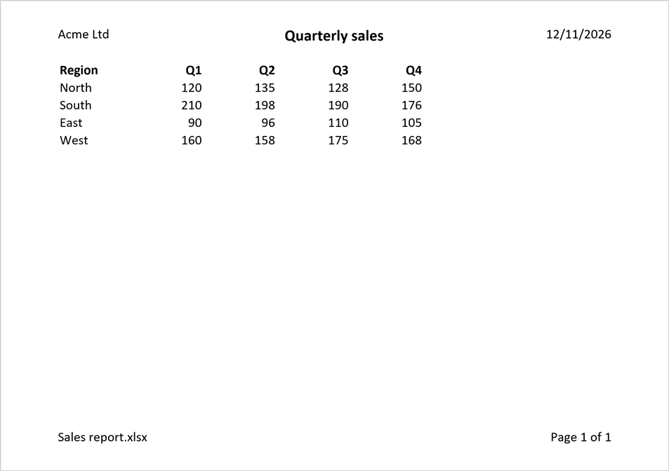

# Printing

Setting up a sheet for printing changes the workbook, so open the file with `mode="rw"` (or start from
[`XLSX.newxlsx`](@ref)). The settings can be read from any file.

[`XLSX.setPageSetup`](@ref) sets the orientation, paper size and scaling, as
Excel's *Page Setup* dialog does:

```julia
XLSX.setPageSetup(sheet; orientation=:landscape, paperSize=:A4)
XLSX.setPageSetup(sheet; fitToWidth=1)   # one page wide, as many pages tall as needed
XLSX.setPageSetup(sheet; scale=75)       # or print at 75%
```

The margins are set in inches, and print options choose whether gridlines and
row and column headings are printed, and whether the sheet is centred on the page:

```julia
XLSX.setPageMargins(sheet; left=0.5, right=0.5, top=0.75, bottom=0.75)
XLSX.setPrintOptions(sheet; gridLines=true, horizontalCentered=true)
```

A print area limits what is printed, and print titles repeat rows at the top of
each page, or columns at its left:

```julia
XLSX.setPrintArea(sheet, "A1:H60")
XLSX.setPrintTitles(sheet; rows=1)          # repeat the header row on every page
XLSX.setPrintTitles(sheet; rows=1:2, cols="A")
```

Excel keeps these two as names scoped to the sheet, `_xlnm.Print_Area` and
`_xlnm.Print_Titles`, which are kept up to date as sheets are renamed, copied
and deleted.

Each setting can be read back with [`XLSX.getPageSetup`](@ref),
[`XLSX.getPageMargins`](@ref), [`XLSX.getPrintOptions`](@ref),
[`XLSX.getPrintArea`](@ref) and [`XLSX.getPrintTitles`](@ref), and the print
area and titles removed with [`XLSX.removePrintArea`](@ref) and
[`XLSX.removePrintTitles`](@ref).

## Headers and footers

[`XLSX.setHeaderFooter`](@ref) sets the header and footer printed on every page, as
Excel's *Page Setup → Header/Footer* does. Each has a left, a centre and a right
section; a single string is centred:

```jldoctest headerfooter; setup = :(import XLSX)
julia> s = XLSX.newxlsx()[1];

julia> XLSX.setHeaderFooter(s; header=(left="Sales", right="Page &P of &N"), footer="&F");

julia> XLSX.getHeaderFooter(s).header
(left = "Sales", center = nothing, right = "Page &P of &N")
```

Excel replaces codes such as `&P` (the page number) and `&N` (the number of pages)
when it prints. [`XLSX.headerFooterField`](@ref) gives them by name, and
[`XLSX.headerFooterFont`](@ref) gives the codes that change the font of the text
after them:

```jldoctest headerfooter
julia> title = XLSX.headerFooterFont(bold=true, size=14) * "Quarterly report"
"&\"-,Bold\"&14Quarterly report"

julia> XLSX.setHeaderFooter(s; header=(center=title,), footer=(right=XLSX.headerFooterField(:sheet),));
```

| Code | Printed as | | Code | Printed as |
|:-----|:-----------|:-|:-----|:-----------|
| `&P` | page number | | `&F` | file name |
| `&N` | number of pages | | `&Z` | file's folder |
| `&D` | date | | `&A` | sheet name |
| `&T` | time | | `&&` | an ampersand, `&` |

This page was printed from a sheet set up with:

```julia
XLSX.setHeaderFooter(sheet;
    header=(left="Acme Ltd", center=XLSX.headerFooterFont(bold=true, size=14) * "Quarterly sales", right="&D"),
    footer=(left="&F", right="Page &P of &N"))
```



The first page, and even pages, can have headers and footers of their own:

```julia
XLSX.setHeaderFooter(sheet; firstHeader="")                      # nothing above the title page
XLSX.setHeaderFooter(sheet; footer=(right="&P",), evenFooter=(left="&P",))   # page numbers on the outside edge
```

A new header or footer replaces the old one whole, and `""` removes it;
[`XLSX.removeHeaderFooter`](@ref) removes them all. A header or footer holds at
most 255 characters, codes included, as in Excel. Pictures in headers and footers
aren't supported. [`XLSX.setPageMargins`](@ref) sets how far they are from the
edge of the page.

## See also

- API: [Page setup and printing](@ref) in Files and worksheets
- Related guides: [Freeze and split panes](../formatting/freezeAndSplitPanes.md), which keep header rows in view on screen as print titles do on paper
