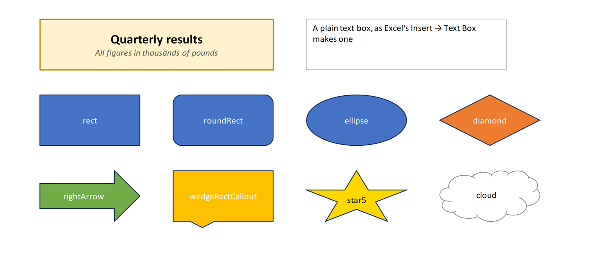

# Text boxes and shapes

Text boxes and shapes float over the cells, as images do, to label a sheet, explain a
table or point at a result. [`XLSX.addTextBox`](@ref) adds a text box, as Excel's
*Insert → Text Box* does, and [`XLSX.addShape`](@ref) adds a rectangle, oval, arrow,
callout or other shape, as *Insert → Shapes* does. The file must be open for writing
(`mode="rw"`, or a new workbook from [`XLSX.newxlsx`](@ref)).



```jldoctest shapes; setup = :(import XLSX)
julia> s = XLSX.newxlsx()[1];

julia> XLSX.addTextBox(s, "B2:H5", "Quarterly results\nAll figures in thousands";
                       font=(size=14, bold=true), fill="FFF2CC", horizontal=:center, vertical=:middle)
(sheet = "Sheet1", name = "TextBox 1", from = "B2", to = "H5")

julia> XLSX.addShape(s, "B8:D11", :roundRect; text="Start here", horizontal=:center, vertical=:middle)
(sheet = "Sheet1", name = "Rectangle: Rounded Corners 2", from = "B8", to = "D11")
```

## Where it goes

Like an image, the object covers a range of cells (`"B2:H5"`), or starts at a cell and
takes its `size` in pixels, snapped to whole cells. It moves with its cells when rows
and columns are inserted and deleted. Deleting all the rows or columns under it deletes
it too.

## Text

The text is a string, in which `"\n"` starts a new paragraph, or a
[`RichTextString`](@ref XLSX.RichTextString) for parts in different fonts, as in a cell:

```julia
title = XLSX.RichTextString(
    XLSX.RichTextRun("Quarterly results", [:bold => true, :size => 16]),
    XLSX.RichTextRun("\nAll figures in thousands of pounds", [:italic => true, :color => "595959"]))
XLSX.addTextBox(sheet, "B2:H5", title; fill="FFF2CC", line="BF9000", lineWidth=1.5)
```

`font` sets the font of the whole text, with the settings [`XLSX.setFont`](@ref) takes:
`bold`, `italic`, `under`, `strike`, `size`, `color`, `name` and `vertAlign`. A rich text
run's own settings take precedence. `horizontal` (`:left`, `:center`, `:right`,
`:justify`) and `vertical` (`:top`, `:middle`, `:bottom`) place the text in the box.

## Fill and border

A text box is white with a thin grey border, and a shape takes Excel's default style:
the theme's first accent colour with white text. `fill` gives another colour, or `:none`
to see through it, and `line`, `lineWidth` and `lineDash` the border's colour (or
`:none`), width in points and dashes. Colours can be given in any of the forms in
[Specifying colors](@ref), including theme colours such as `:accent2`.

```julia
XLSX.addShape(sheet, "N8:P11", :diamond; text="Check", fill=:accent2)
XLSX.addShape(sheet, "J14:L17", :star5; fill="gold", line=:none, font=(color="black",))
```

The shapes are `:rect`, `:roundRect`, `:ellipse`, `:triangle`, `:rtTriangle`, `:diamond`, `:parallelogram`, `:trapezoid`, `:pentagon`, `:hexagon`, `:octagon`, `:plus`, `:star5`, `:rightArrow`, `:leftArrow`, `:upArrow`, `:downArrow`, `:leftRightArrow`, `:chevron`, `:homePlate`, `:wedgeRectCallout`, `:wedgeRoundRectCallout`, `:wedgeEllipseCallout`, `:cloud`, `:heart`, `:lightningBolt`, `:sun`, `:moon`, `:smileyFace`, `:flowChartProcess`, `:flowChartDecision`, `:flowChartTerminator`, `:can`, `:cube`.

## Reading and deleting

[`XLSX.getShapes`](@ref) lists a sheet's text boxes and shapes with their names, kinds,
cells and text, from any file. [`XLSX.deleteShape`](@ref) deletes those at a cell, or the
one with a given name. Images and charts are separate: see [Images](images.md) and
[Charts](../charts/excelCharts.md).

```jldoctest shapes
julia> [(sh.name, sh.kind, sh.text) for sh in XLSX.getShapes(s)]
2-element Vector{Tuple{String, Symbol, String}}:
 ("TextBox 1", :textbox, "Quarterly results\nAll figures in thousands")
 ("Rectangle: Rounded Corners 2", :roundRect, "Start here")

julia> XLSX.deleteShape(s, "B8")
1
```

## See also

- API: [Text boxes and shapes](../api/objects.md#Text-boxes-and-shapes) in Images, comments and hyperlinks
- Related guides: [Images](images.md), which are anchored the same way
